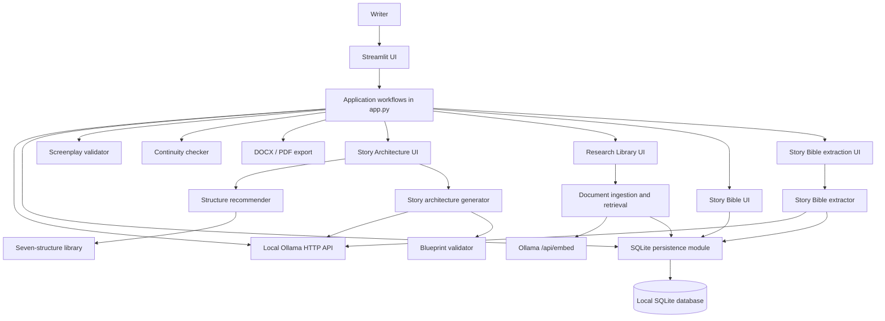

# Architecture

## 1. System overview

Screenwriter Studio is a local-first Streamlit application. The user interacts with the Streamlit interface, the application prepares prompts and coordinates workflows, and a locally running Ollama server performs language-model inference. SQLite stores project metadata, writing workspaces and Story Bible records.



The diagram describes the current code organization. It is not a claim that the application already has a fully separated service or API layer.

## 2. Main components

| Component | Responsibility |
|---|---|
| `app.py` | Streamlit application, project controls, prompt construction, scene workflows, direct Ollama HTTP requests, session-state coordination, and DOCX/PDF exports |
| `story_bible.py` | SQLite schema, project metadata, project workspace persistence, Story Bible CRUD operations, and Story Bible prompt context |
| `story_bible_ui.py` | Streamlit interface for manually managing Story Bible entries |
| `story_bible_extractor.py` | Extraction prompt, JSON parsing, category/field validation, duplicate handling, and explicit-approval persistence |
| `story_bible_extraction_ui.py` | Extraction interaction: request candidates, review/edit JSON, check source/project identity, and approve saving |
| `screenplay_validator.py` | Deterministic heuristic checks for selected screenplay-format issues |
| `continuity_checker.py` | Deterministic checks for explicit numeric character-age conflicts against Story Bible ages |
| `story_structure.py` | Structured reference definitions for seven narrative frameworks, with genre affinities, audience experiences, strengths, cautions, components, and complements |
| `structure_recommender.py` | Deterministic recommendations with score breakdowns, matched reasons, caveats, and complementary structures |
| `story_architecture.py` | Framework-specific prompt construction, injectable LLM generation, JSON parsing, beat-order validation, and approved-architecture prompt context formatting |
| `story_architecture_ui.py` | Streamlit interface for recommendations, architecture generation, JSON editing, validation, and project-persistent writer approval |
| `research_rag.py` | PDF/DOCX/TXT/Markdown text extraction, overlapping chunking, Ollama embeddings, SQLite vector persistence, cosine retrieval and source-labelled context |
| `research_rag_ui.py` | Research document upload, indexing, source management and semantic search interface |
| `screenplay_formats.py` | Format catalog, per-format runtime ranges, duration validation, complete-script blueprint sections and prompt instructions for Advertisement, TVC and Micro Drama |
| `scene_evaluator.py` | Experimental scene-evaluation logic; not connected to the active application workflow |
| `tests/` | Unit tests for persistence, extraction, continuity checks, screenplay validation, structure recommendations, and architecture generation |

## 3. Story structure recommendation layer

The story-structure layer now includes the seven-framework reference library, a transparent recommender, and a Streamlit story-architecture workflow.

- `story_structure.py` stores the seven framework definitions under stable IDs.
- `structure_recommender.py` normalizes input aliases, ranks structures, and returns score breakdowns, match reasons, strengths, cautions, and complementary structure IDs.
- `story_architecture.py` builds structure-specific prompts, calls an injected LLM function, parses model JSON, validates required story fields and exact ordered beat coverage, and formats approved architecture as prompt context.
- `story_architecture_ui.py` provides recommendation inputs, a primary structure selector, generation, a JSON editor, and an explicit validation-and-approval action.
- `docs/STORY_STRUCTURE_ENGINE.md` documents the framework library, scoring method, blueprint schema, usage and research limitations.
- `tests/test_story_structure.py` and `tests/test_story_architecture.py` cover recommendation and blueprint behavior.

The recommender uses a transparent maximum 15-point heuristic: 5 points for a storytelling-engine match, up to 6 points for audience-experience matches, and up to 4 points for genre-affinity matches. A score is not a probability or a measured quality estimate. If no criteria match, Three-Act Structure is shown as an explicitly labelled general-purpose fallback.

The UI passes the project's genre and story brief to the recommender and blueprint generator. The writer can add intended audience experiences and select a dominant storytelling engine, override the recommended framework, edit the generated JSON, and approve it only if the selected framework's components are present exactly once and in the required order. Editing the JSON or changing the selected framework invalidates prior approval.

Approved architecture is stored in `project_story_architectures` as project-scoped JSON. The UI validates it when restoring a project, and prompt construction includes only the saved approved architecture. Editing or changing the selected structure invalidates the approval and removes the stored approved version. Changing a project's format or target runtime also invalidates the plan and architecture so stale constraints are not reused.

## 4. Core data flow

### Scene planning and generation

1. The writer configures a project and chooses a screenplay format.
2. For Advertisement and TVC, the target runtime must be 15–120 seconds. For Micro Drama, it must be 150–200 seconds. These limits are inclusive and selected in whole seconds.
3. The app combines the project format/runtime, metadata, approved Story Architecture and saved Story Bible facts into prompt context; optional RAG retrieves supporting research.
4. For Feature Film, OTT / Web Series and Short Film, the app asks Ollama to propose a scene blueprint. The writer reviews and edits it, then explicitly approves it before drafting that scene.
5. For Advertisement, TVC and Micro Drama, the app asks Ollama for a complete timed shot/scene blueprint. The writer reviews and edits the full-script plan, then explicitly approves it before generating the complete commercial or micro drama in one output.
6. Approved Story Architecture and the screenplay/workspace state are saved locally.

The approval step keeps the writer in control of the scene plan. The model output is a proposal, not an automatically accepted instruction.


### Short-form formats: Advertisement, TVC and Micro Drama

The format selector exposes the same fixed runtime policy as the prompt and validation layer:

- Advertisement: 15–120 seconds.
- TVC: 15–120 seconds.
- Micro Drama: 150–200 seconds.

The selected whole-second runtime is saved as `duration_seconds` in the project's metadata. `screenplay_formats.py` validates the range, builds format-specific guidance and provides distinct blueprint fields:

- Advertisement/TVC blueprints cover the audience hook, target audience, product/brand, single-minded message, supplied benefit, CTA, timed shot breakdown, brand reveal/end card, production considerations and unsupplied claims.
- Micro Drama blueprints cover the dramatic hook, protagonist/objective, central conflict, emotional stakes, timed scene breakdown, escalation, payoff/reversal/cliffhanger, cast/location requirements and continuity.

For these compact formats, the app replaces the scene-by-scene buttons with **Plan Complete Script** and **Generate Complete Script**. It instructs the model to create timed segments that add up to the selected runtime and includes the runtime in Story Architecture prompts. Editing the format or runtime invalidates the existing scene blueprint and approved Story Architecture. The LLM-proposed timing is a planning target and should be checked against performance, pauses, VO, music and edit duration during production.

### Story architecture generation and review

1. The writer opens Story Architecture in the active project.
2. The recommender ranks frameworks using project genre, audience-experience choices, and a selected storytelling engine.
3. The writer selects or overrides the primary framework.
4. The application builds a framework-specific JSON prompt using the project's story brief and the framework's exact ordered components.
5. The injected Ollama call proposes a story-wide blueprint.
6. The application parses and validates the response: required story fields must be present, the selected structure ID must match, and every expected component must appear exactly once and in order.
7. The writer edits the JSON and explicitly approves it after validation.

Generation and approval are separate from persistence. Only validated, explicitly approved architecture is stored in SQLite and included in scene-planning and screenplay-generation prompts. For Advertisement, TVC and Micro Drama, the selected runtime and format guidance are also included in the architecture prompt.


### Research Library and RAG retrieval

1. The writer uploads PDF, DOCX, TXT or Markdown files to the active project.
2. The ingestion layer extracts text. PDF extraction retains page numbers for pages with readable text.
3. Text is split into 220-word chunks with a 40-word overlap (up to 500 chunks per document).
4. The app sends chunk batches to the configured Ollama host's `/api/embed` endpoint. The default embedding model is `nomic-embed-text:latest`.
5. Original chunk text, source filename, page metadata and embedding vectors are stored in SQLite, scoped to the active project.
6. A search query is embedded with the same model. The app computes cosine similarity against that project's stored vectors and returns the top-k matching chunks.
7. The Research Library UI displays excerpts with source labels. When **Use retrieved research in AI prompts** is enabled, up to four relevant excerpts are attached to writing context with filename/page references.

Story Bible facts and retrieved research are kept in separate prompt sections: Story Bible records are continuity constraints; RAG excerpts are supporting reference material. The writer can inspect sources rather than treating generated statements as verified facts.

Retrieval currently uses a brute-force cosine scan over local SQLite vectors. The implementation does not include a dedicated vector database, hybrid keyword retrieval, reranking, OCR for scanned PDFs, or a formal retrieval-evaluation dataset. Uploaded files are limited to 10 MB and 500 chunks. PDF text extraction may not preserve complex page layouts.

### Story Bible extraction

1. The writer requests extraction from the current screenplay.
2. The app sends screenplay text to the local model with instructions to extract only supported facts.
3. The extractor parses the returned JSON and validates entity categories and category-specific fields.
4. The writer reviews and edits the candidate JSON in the UI.
5. The save workflow checks that the candidates still belong to the current project and screenplay version.
6. Saving requires explicit writer approval. Existing matching records have additional overwrite protection.

The current extractor processes at most the first 8,000 characters of screenplay text. Extraction results should be treated as suggestions and reviewed for accuracy.

### Validation and continuity checks

The screenplay validator and continuity checker are deterministic Python modules; they do not ask an LLM to judge the screenplay.

- The format validator flags a limited set of likely formatting problems using pattern-based heuristics.
- The continuity checker compares explicit age phrasings in screenplay text with numeric ages saved for characters in the Story Bible.

These tools do not prove that a screenplay is error-free. They only report issues covered by their implemented rules.

## 5. Persistence model

The SQLite database is local to the machine by default and is created automatically.

Approved story architectures are stored per project in SQLite and revalidated when restored. Research document metadata, extracted chunks and embedding vectors are also stored per project in SQLite.

The main tables are:

- `projects`: project title and JSON metadata such as format, language, genre, tone, logline and writing guidance.
- `project_workspaces`: screenplay text, Scene Blueprint, approval state, previous Script Doctor draft, and last assistant note for a project.
- `project_story_architectures`: one validated, writer-approved architecture JSON record per project.
- `story_bible_entries`: project-linked character, location, prop and timeline records.
- `research_documents`: project-scoped source document metadata and embedding model.
- `research_chunks`: project-scoped source text chunks, PDF page numbers and embedding vectors serialized as JSON.

A project can have one workspace row, one approved architecture row, multiple Story Bible entries, and multiple indexed research documents/chunks. All project-owned rows reference their project through foreign keys. Project titles are unique without case sensitivity; an entry name is unique within a project and category.

The database path can be changed with `SCREENWRITER_DB_PATH`. The default database file is excluded from Git so that screenplay drafts and project facts are not committed accidentally.

## 6. Local model integration

The application discovers available Ollama models through `/api/tags` and sends chat requests to `/api/chat`. The host can be configured with `OLLAMA_HOST`; the default is `http://localhost:11434`.

With the default local Ollama setup, prompts and screenplay text are sent to the Ollama service on the user's machine. A separately configured remote Ollama host would receive those requests instead.

The application currently uses direct HTTP requests from `app.py`; there is not yet a standalone model-client or provider abstraction.

## 7. Testing and continuous integration

Run the unit tests from the repository root:

```bash
python -m unittest discover -s tests -v
```

GitHub Actions runs the same command for Python 3.10 and 3.11 on pushes and pull requests. The suite covers the story-structure knowledge library, recommendation engine, architecture prompt generation, schema validation, beat ordering, persistence, RAG retrieval, and the new short-form format and runtime rules.

The tests focus on deterministic logic, prompt construction, response parsing, beat-order validation, and persistence. They do not replace manual end-to-end testing of the Streamlit interface or tests against every Ollama model. CI also runs Python bytecode compilation to catch syntax errors in application modules.

## 8. Current limitations and next engineering boundaries

- `app.py` still combines UI rendering, workflow orchestration, model request code and document export. Separating these responsibilities is a future refactoring opportunity.
- RAG retrieval is implemented with locally stored embeddings and exact cosine similarity. It is intentionally lightweight and does not currently use a separate vector database, hybrid search, or reranking.
- The continuity checker currently handles explicit numeric character-age references only.
- Exact runtime is a prompt and timed-blueprint requirement, not an automated edit-duration measurement. The final advertisement, TVC or micro-drama cut must still be timed in production.
- Screenplay validation is heuristic and checks a limited set of formatting patterns.
- Extraction is limited to the first 8,000 screenplay characters.
- The scene evaluator is experimental and is not exposed in the active UI.
- Project data is local to the configured SQLite database. Cloud synchronization, multi-user collaboration and authentication are not implemented.

These boundaries are documented so that portfolio reviewers can distinguish implemented behavior from planned work.
