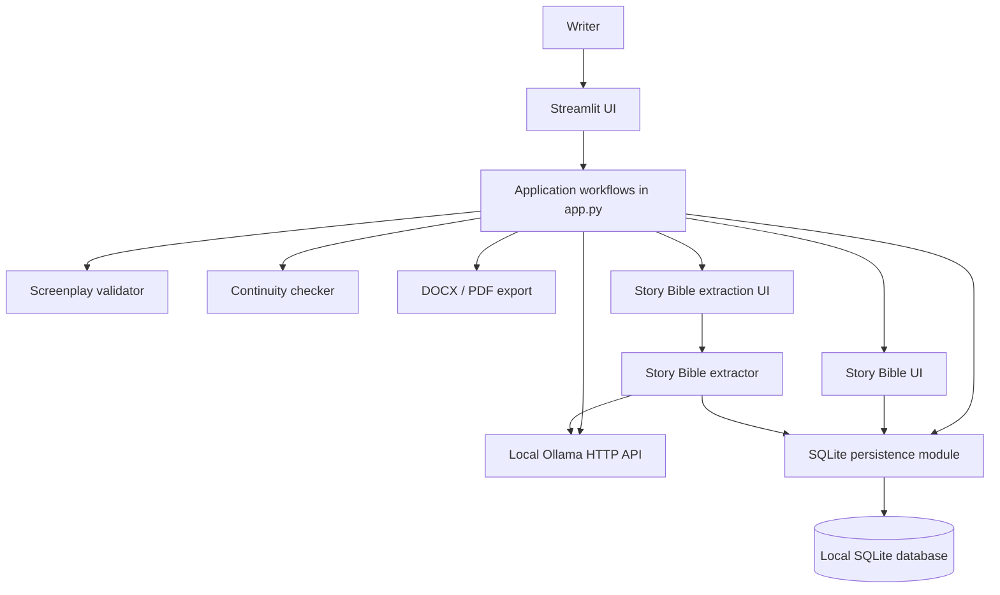

# Architecture

## 1. System overview

Screenwriter Studio is a local-first Streamlit application. The user interacts with the Streamlit interface, the application prepares prompts and coordinates workflows, and a locally running Ollama server performs language-model inference. SQLite stores project metadata, writing workspaces and Story Bible records.



The diagram describes the current code organization. It is not a claim that the application already has a fully separated service or API layer.

## 2. Main components

| Component | Responsibility |
|---|---|
| `app.py` | Streamlit application, project controls, prompt construction, scene workflows, direct Ollama HTTP requests, session-state coordination, and DOCX/PDF exports |
| `story_bible.py` | SQLite schema, project metadata, project workspace persistence, Story Bible CRUD operations, and Story Bible prompt context |
| `story_bible_ui.py` | Streamlit interface for manually managing Story Bible entries |
| `story_bible_extractor.py` | Extraction prompt, JSON parsing, category/field validation, duplicate handling, and explicit-approval persistence |
| `story_bible_extraction_ui.py` | Extraction interaction: request candidates, review/edit JSON, check source/project identity, and approve saving |
| `screenplay_validator.py` | Deterministic heuristic checks for selected screenplay-format issues |
| `continuity_checker.py` | Deterministic checks for explicit numeric character-age conflicts against Story Bible ages |
| `story_structure.py` | Structured reference definitions for seven narrative frameworks, with genre affinities, audience experiences, strengths, cautions, components, and complements |\n| `structure_recommender.py` | Deterministic, explainable recommendations using genre, audience experience, and storytelling engine |\n| `scene_evaluator.py` | Experimental scene-evaluation logic; not connected to the active application workflow |
| `tests/` | Unit tests for persistence, extraction, continuity checks, screenplay validation, and the experimental evaluator |

## 3. Story structure recommendation layer

The story-structure recommendation layer is implemented as independent Python modules and is not yet connected to the Streamlit project-creation workflow.

- `story_structure.py` stores the seven framework definitions under stable IDs.
- `structure_recommender.py` normalizes input aliases, ranks structures, and returns score breakdowns, match reasons, strengths, cautions, and complementary structure IDs.
- `docs/STORY_STRUCTURE_ENGINE.md` documents the scoring method, usage and research limitations.
- `tests/test_story_structure.py` covers the reference library and recommendation behavior.

The recommender uses a transparent maximum 15-point heuristic: 5 points for a storytelling-engine match, up to 6 points for audience-experience matches, and up to 4 points for genre-affinity matches. A score is not a probability or a measured quality estimate. If no criteria match, Three-Act Structure is shown as an explicitly labelled general-purpose fallback.

The next integration phase is to let a writer select and approve a story-wide architecture, persist it with the project workspace, and pass its relevant structural context into scene planning. That integration has not been implemented in this phase.

## 4. Core data flow

### Scene planning and generation

1. The writer configures a project in the sidebar.
2. The app combines project metadata and saved Story Bible facts into prompt context.
3. The app sends a request to Ollama's `/api/chat` endpoint.
4. The model proposes a Scene Blueprint.
5. The writer reviews and can edit the blueprint, then explicitly approves it.
6. The app sends the approved blueprint and project context to Ollama to draft the scene.
7. The screenplay and workspace state are saved locally.

The approval step keeps the writer in control of the scene plan. The model output is a proposal, not an automatically accepted instruction.

### Story Bible extraction

1. The writer requests extraction from the current screenplay.
2. The app sends screenplay text to the local model with instructions to extract only supported facts.
3. The extractor parses the returned JSON and validates entity categories and category-specific fields.
4. The writer reviews and edits the candidate JSON in the UI.
5. The save workflow checks that the candidates still belong to the current project and screenplay version.
6. Saving requires explicit writer approval. Existing matching records have additional overwrite protection.

The current extractor processes at most the first 8,000 characters of screenplay text. Extraction results should be treated as suggestions and reviewed for accuracy.

### Validation and continuity checks

The screenplay validator and continuity checker are deterministic Python modules; they do not ask an LLM to judge the screenplay.

- The format validator flags a limited set of likely formatting problems using pattern-based heuristics.
- The continuity checker compares explicit age phrasings in screenplay text with numeric ages saved for characters in the Story Bible.

These tools do not prove that a screenplay is error-free. They only report issues covered by their implemented rules.

## 4. Persistence model

The SQLite database is local to the machine by default and is created automatically.

The main tables are:

- `projects`: project title and JSON metadata such as format, language, genre, tone, logline and writing guidance.
- `project_workspaces`: screenplay text, Scene Blueprint, approval state, previous Script Doctor draft, and last assistant note for a project.
- `story_bible_entries`: project-linked character, location, prop and timeline records.

A project can have one workspace row and multiple Story Bible entries. Story Bible entries reference their project through a foreign key. Project titles are unique without case sensitivity; an entry name is unique within a project and category.

The database path can be changed with `SCREENWRITER_DB_PATH`. The default database file is excluded from Git so that screenplay drafts and project facts are not committed accidentally.

## 5. Local model integration

The application discovers available Ollama models through `/api/tags` and sends chat requests to `/api/chat`. The host can be configured with `OLLAMA_HOST`; the default is `http://localhost:11434`.

With the default local Ollama setup, prompts and screenplay text are sent to the Ollama service on the user's machine. A separately configured remote Ollama host would receive those requests instead.

The application currently uses direct HTTP requests from `app.py`; there is not yet a standalone model-client or provider abstraction.

## 6. Testing and continuous integration

Run the unit tests from the repository root:

```bash
python -m unittest discover -s tests -v
```

GitHub Actions runs the same command for Python 3.10 and 3.11 on pushes and pull requests. At the time this architecture document was added, the local suite contained 42 passing tests and both CI matrix jobs had passed.

The tests focus on deterministic logic and persistence. They do not replace manual end-to-end testing of the Streamlit interface or tests against every Ollama model.

## 7. Current limitations and next engineering boundaries

- `app.py` still combines UI rendering, workflow orchestration, model request code and document export. Separating these responsibilities is a future refactoring opportunity.
- There is no RAG pipeline, vector database or semantic retrieval layer. Story Bible context is currently included as bounded text.
- The continuity checker currently handles explicit numeric character-age references only.
- Screenplay validation is heuristic and checks a limited set of formatting patterns.
- Extraction is limited to the first 8,000 screenplay characters.
- The scene evaluator is experimental and is not exposed in the active UI.
- Project data is local to the configured SQLite database. Cloud synchronization, multi-user collaboration and authentication are not implemented.

These boundaries are documented so that portfolio reviewers can distinguish implemented behavior from planned work.
